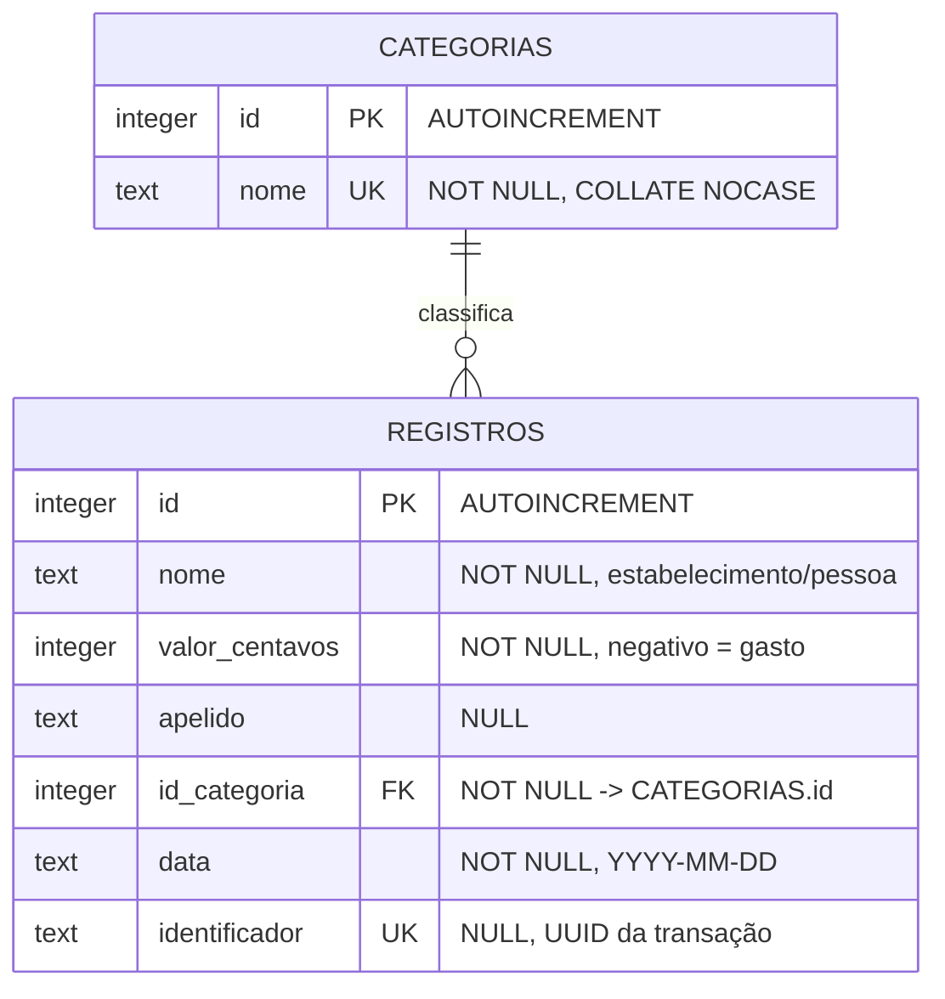

# Banco de dados e modelo do CSV

SQLite, arquivo `%LOCALAPPDATA%\SmartFin\smartfin.db` (pasta criada na primeira execução). Valores monetários são armazenados em centavos (`INTEGER`) e datas em `TEXT` no formato `YYYY-MM-DD`.

## Modelo relacional

- `identificador` é único quando presente; `NULL` é permitido para registros criados manualmente.
- Exclusão de categorias não é exposta na interface; a recolha de dados remove registros antes das categorias.
- `versao_dados()` resume `COUNT`, `MAX(id)` e `SUM(valor_centavos)` dos registros para invalidar o cache do dashboard.

## Modelo do CSV (Nubank)

| Coluna | Conteúdo | Uso no sistema |
|---|---|---|
| `Data` | data da transação (`dd/mm/aaaa`) | convertida para `YYYY-MM-DD` |
| `Valor` | float, positivo = entrada, negativo = saída | convertido para centavos inteiros |
| `Descrição` | texto livre (estabelecimento, Pix, estorno, RDB, fatura) | limpeza + extração do nome |
| `Identificador` | UUID da transação | deduplicação na importação |

Regras de limpeza aplicadas à descrição antes da classificação:

1. Prefixos conhecidos são removidos repetidamente: `Compra no débito`, `Compra no débito via NuPay`, `Transferência enviada/recebida pelo Pix`, `Estorno`, `Pagamento de fatura`, `Aplicação RDB`, entre outros.
2. O nome é o primeiro segmento antes de ` - ` do restante (ex.: banco, agência e conta do Pix são descartados).
3. Se nada restar, a descrição original é usada como nome.
