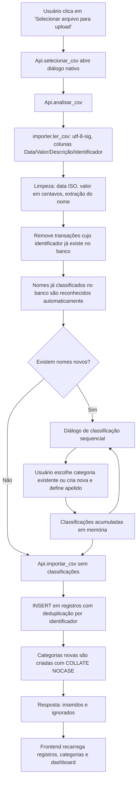

# Processo de importação do CSV ao banco



## Contrato de classificações

O frontend envia uma lista equivalente ao dicionário de classificação do fluxo original:

```json
[
  { "nome": "Uber", "id_categoria": 2, "apelido": "Transporte app" },
  { "nome": "Padaria Central", "categoria_nome": "Alimentação", "apelido": "Padaria" }
]
```

- `id_categoria` referencia categoria existente; `categoria_nome` cria a categoria se necessário.
- O nome classificado passa a valer para todas as transações do mesmo arquivo e para importações futuras (mapeamento persistido em `registros`).
- Nomes sem classificação caem na categoria `Outros`.

## Garantias

- Nenhuma transação é gravada antes do fim da classificação.
- Reimportar o mesmo arquivo resulta em `inseridos = 0` (deduplicação pelo `Identificador`).
- Linhas com valor zero são ignoradas.
