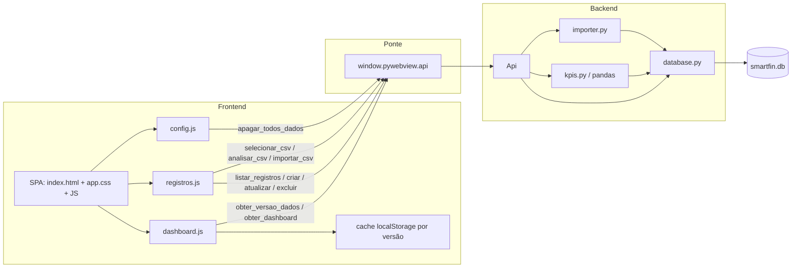

# Processo da Web até o banco de dados

## Métodos expostos (`src/backend/api.py`)

| Método | Consumo | Descrição |
|---|---|---|
| `obter_dashboard(estado, filtros)` | Dashboard | KPIs, top gastos e séries de gráficos via pandas |
| `obter_versao_dados()` | Dashboard | Chave de invalidação do cache |
| `listar_registros(filtros)` | Registros | Filtros por nome, valor, apelido, categoria e período |
| `criar_registro`, `atualizar_registro`, `excluir_registro` | Registros | CRUD validado |
| `listar_categorias`, `criar_categoria` | Registros | Categorias disponíveis |
| `selecionar_csv`, `analisar_csv`, `importar_csv` | Registros | Pipeline de importação |
| `apagar_todos_dados()` | Configurações | Exclusão total com confirmação no frontend |

## Cache do dashboard

1. O frontend chama `obter_versao_dados()`.
2. A chave `smartfin:dashboard:<versao>:<estado>:<filtros>` é consultada no `localStorage`.
3. Em caso de acerto, os dados são renderizados sem nova análise pandas.
4. Em caso de falta (ou de qualquer escrita no banco), a API é chamada e o resultado é armazenado; caches de versões antigas são removidos.

## Estados de interface

- Tema aplicado via `data-theme` no `<html>` e persistido em `smartfin:tema`.
- Regiões `aria-live` anunciam filtros, status de importação e resultados.
- Diálogos usam o elemento nativo `<dialog>`, com foco preso, `Esc` para fechar e confirmação para ações destrutivas.
